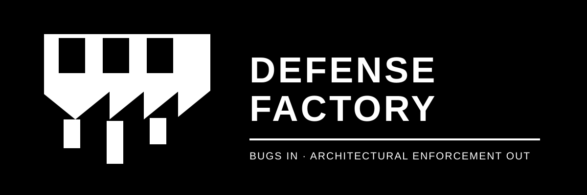
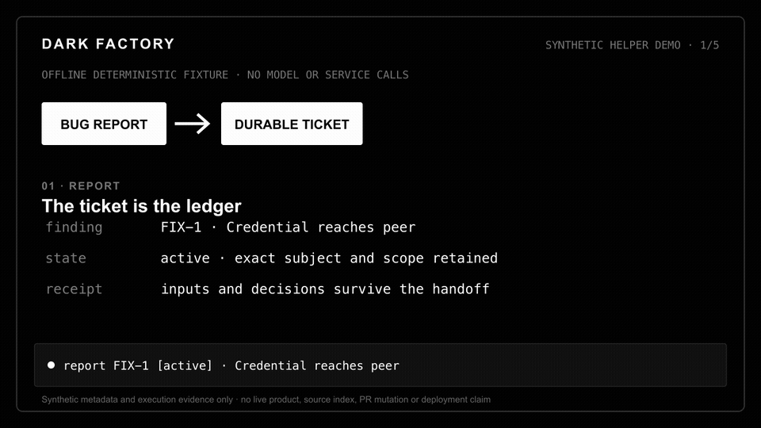
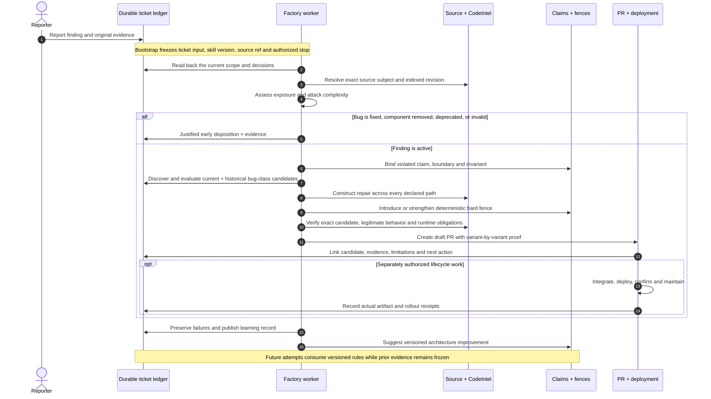

<div align="center">
  
  <h3>A dark factory turning bugs into architectural enforcement.</h3>
  <p><strong>Bugs go in security architecture comes out.</strong></p>
  <p>
    <a href="https://jerkeby.se">jerkeby.se</a> ·
    <a href="#try-the-factory-offline">Quickstart</a> ·
    <a href="#the-end-to-end-flow">How it works</a> ·
    <a href="#claims-contracts-and-fences">Claims &amp; fences</a> ·
    <a href="#evidence-and-limitations">Evidence</a>
  </p>
  <p>
    
    
    
    <a href="LICENSE"></a>
  </p>
</div>

Defense Factory is a ticket-driven security-remediation workflow for developers
and security reviewers. A finding is qualified against an exact source subject,
expanded into an architectural bug class, repaired at the boundary it violates,
and bound to a deterministic hard fence. The ticket is the durable ledger:
inputs, decisions, evidence, failures and the next action survive every stage
handoff.

> [!IMPORTANT]
> This is an **experimental, manually operated workflow**. It does not provide
> enforced agent isolation, independent acceptance or demonstrated reliable
> end-to-end autonomy. Human review is required. Installing it does not install
> a scheduler, CI, branch protection, credentials or production deployment.

## See the idea in 10 seconds



This animation replays a **deterministic, offline helper fixture**. It proves the
displayed helper path, not a live remediation or autonomous product change.
[Watch the WebM](docs/assets/dark-factory-demo.webm), inspect the
[structured record](docs/demo/synthetic-trial.json), or read the
[media provenance](docs/demo/README.md). Static evidence frames show the
[report](docs/assets/dark-factory-demo-report.png),
[repair](docs/assets/dark-factory-demo-repair.png), and
[versioned learning](docs/assets/dark-factory-demo-learn.png) handoffs.

## The end-to-end flow



The important output is not simply “bug fixed.” It is a portable claim about
what the component is allowed to do, one or more executable contracts that find
possible violations, a hard fence that controls the relevant flow, and receipts
showing what was actually evaluated.

## Try the factory offline

The fastest trustworthy first look makes no model, ticket, CodeIntel, product,
pull-request or deployment call:

```sh
git clone https://github.com/kugg/defensefactory.git
cd defensefactory
python3 docs/demo/synthetic_trial.py
python3 -m unittest discover -s tests -v
python3 skills/defensefactory/scripts/eval-rules.py --output /tmp/factory-rules-eval-new
python3 skills/defensefactory/scripts/eval-stage-rules.py \
  --skills skills --output /tmp/factory-stage-rules-eval-new
```

The synthetic transcript should end with a generated PR proof section, an exact
merge subject and an explicit “no live product or deployment claim” limitation.
The broader evaluations exercise disposable Git and Go fixtures and refuse to
overwrite prior output.

## Bootstrap a real practice environment

Python 3.10+ and OpenCode are required. Git is required for source operations;
the bundled evaluation also uses Go 1.22+. Product toolchains and end-to-end
plans come from the ticket.

```sh
./scripts/install-defensefactory --check
./scripts/install-defensefactory --plan --installation-id my-practice
./scripts/install-defensefactory --install --installation-id my-practice
```

The bootstrap is a trust boundary, not setup ceremony. It inventories mandatory
and optional capabilities, separates a disposable practice target from a
production plan, records the selected model and ticket project, and asks for
CodeIntel or an exact-revision equivalent. It records missing confidence layers
instead of pretending they ran. It never asks for credential values: profiles
use references such as `env:NAME`, `op://…` or `keychain://…`.

`scripts/install-defensefactory` is the only supported installer entry point.
It creates an immutable, versioned release plus a nonsecret environment profile;
it does not grant merge, deployment, lifecycle or production authority. See the
[installation guide](skills/defensefactory/references/installation.md) and
[manual trial controls](skills/defensefactory/references/trial-controls.md).

## Claims, contracts and fences

Each component owns one concise `RULES.md`—the repository root may itself be the
component. Developers change it under the same repository policy as their code,
dependencies and CODEOWNERS.

| Concept | What it records | Example |
| --- | --- | --- |
| **Claim** | The boundary within which a component is allowed to exist. | Credentials reach only a verified peer. |
| **Contract** | A runnable candidate detector for an invariant. False positives are expected and evaluated. | A test, type, CUE constraint, CodeQL/Semgrep query, runtime assertion or formal model. |
| **Hard fence** | A deterministic control that governs the relevant flow. | A regression test and peer-identity type that every credential path must satisfy. |
| **Soft fence** | Intent and review guidance complementing hard controls. | `AGENTS.md`, review policy or an architectural explanation. |
| **Receipt** | Computed identity and result for an exact attempt. | Git ref, artifact hash, execution result and evidence locator. |

Claims remain portable when a component moves. They reference their controls and
the Git refs that introduced them; changing repositories does not change their
meaning. Hashes and verdicts stay in receipts, not authored claim definitions.
Checker output creates candidates. A separate evaluation decides whether the
claim holds. Read [component claims](skills/defensefactory/references/component-claims.md)
and [architectural bug classes](skills/defensefactory/references/bug-classes.md).

## Stage pipeline

| Stage | Durable outcome |
| --- | --- |
| **Intake** | Finding, original evidence, exact source and authorized scope. |
| **Assess** | Early disposition, or active exposure, attack complexity and repair obligations. |
| **Repair** | Bounded candidate restoring the governing claim across the declared bug class. |
| **Verify** | Exact-subject security, behavior, architecture and runtime evidence. |
| **Integrate** | Merge-subject and governing-policy decision. |
| **Deploy** | Identified artifact rolled out only within separately authorized scope. |
| **Confirm** | Actual deployed artifact, configuration and rollout scope checked. |
| **Maintain** | Explicit drift, exception and new-variant pass. |

Every stage has a standalone skill. The orchestration skill routes using freshly
retrieved ticket state; it does not pass an invisible in-memory success claim to
the next stage. See [where handoff state lives](skills/defensefactory/references/handoff-state.md).

## Self-improvement without rewriting history

Failures are factory output. The workflow preserves the failed attempt, records
which rule, helper or handoff was insufficient, changes the skill or fence in a
new version, and evaluates that version in a fresh trial. Old evidence remains
addressable and unchanged. This lets maintainers improve the gradient of
confidence without retroactively making a failed run look successful.

The bootstrap pins the version and environment used by each attempt. The
learning record identifies a future change; it never silently hot-patches an
active or frozen trial. See [lessons and limitations](LESSONS.md) and the
[prepublication checks](VALIDATION.md).

## Evidence and limitations

Source search must be scoped to the exact indexed subject and carry CodeIntel or
equivalent coverage warnings. Formal checks distinguish bounded model results
from implementation conformance. Runtime results identify the selected probe,
artifact and environment. Shareable ticket attachments are retrieved and
verified before the next stage relies on them. A passing process, archive or
helper check does not grant acceptance or closure.

The helpers save comparison inputs, reproduction recipes, artifact bindings,
child exits and evidence inventories. They cannot authenticate arbitrary
caller-supplied connector records or prevent an operator from bypassing them
with unwrapped host commands. Supported paths and remaining qualifications are
documented in [verification paths](skills/defensefactory/references/supported-verification.md),
[fixture/runtime handoff](skills/defensefactory/references/fixture-runtime-handoff.md)
and [evaluation scope](skills/defensefactory/references/evaluation.md).

## Repository map

| Path | Start here when… |
| --- | --- |
| [`skills/`](skills/) | Reading or packaging the orchestration and stage skills. |
| [`scripts/install-defensefactory`](scripts/install-defensefactory) | Qualifying and installing an environment. |
| [`tests/`](tests/) | Inspecting deterministic helper regressions. |
| [`docs/demo/`](docs/demo/) | Reproducing the README evidence and media. |
| [`LESSONS.md`](LESSONS.md) | Reviewing observed failures and unresolved limitations. |
| [`VALIDATION.md`](VALIDATION.md) | Checking the exact prepublication evaluation scope. |

Standalone stage archives are created with
`python3 scripts/package-skills.py --output /new/package-directory`. Every
archive includes the MIT license and inherited universal rule source. Follow
the [stage rules](skills/defensefactory/references/stage-rules.md) before relying
on a packaged stage.
