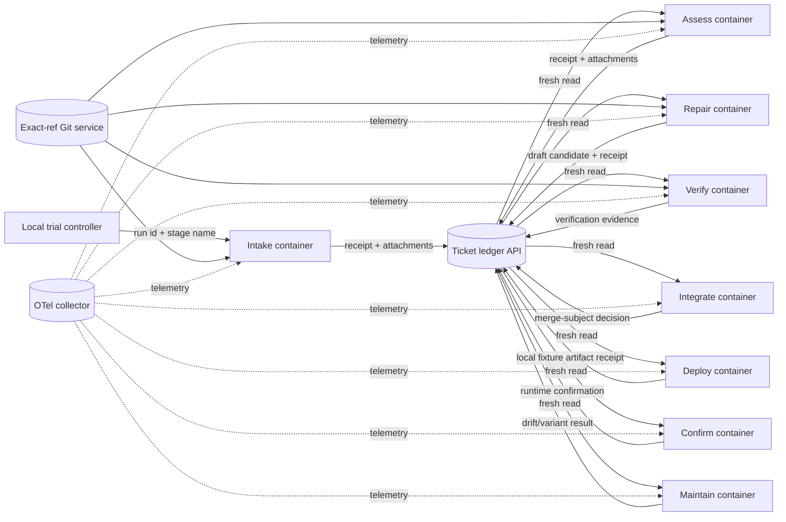

# Defense Factory v0.1.0-alpha.1 release plan

## Release intent

The first alpha demonstrates that the factory can process a finding through
disposable stage environments while preserving an auditable, replayable
handoff. It is a release of the manually operated workflow and its evidence
protocol, not a claim of autonomous remediation or production-safe agent
isolation.

The release candidate uses one immutable OCI image for every stage. Each stage
runs that image with a different skill, capability profile and fresh workspace.
The previous stage container is destroyed before the next stage begins.

## Alpha claim

> Given a frozen ticket, source subject, factory version and authorized scope,
> the factory can execute each stage in a fresh container and reconstruct the
> next stage from the durable ticket and verified evidence bundle alone.

This is the claim the alpha must test. Passing it does not establish hostile
multi-tenant isolation, independent acceptance, reliable unattended autonomy,
or authority to merge or deploy a real product.

## Candidate boundary

The release candidate is `v0.1.0-alpha.1`. It is cut only after:

1. the current workflow-gate change is merged;
2. its seven linked gate evaluations have been reconciled;
3. the exact release commit passes the repository, package and container tests;
4. the stage-handoff experiment below passes from the published image digest;
5. remaining limitations are recorded in the release notes.

The candidate is identified by both a Git tag and an OCI image digest. A moving
branch name is not a release subject.

## Environment topology

The local ledger is a test double for a durable ticket system and attachment
store. It is accessed over an API. Stage containers do not share its filesystem
or a writable workspace with one another.

The controller may retain the run id, image digest and next stage name. It must
not carry assessment conclusions, evidence bodies or success flags between
stages in memory.

## Stage isolation contract

Every stage must:

- start from the same pinned image digest;
- run in a new container and a new agent/model session;
- clone or download the exact source subject into a fresh workspace;
- receive only the stage-specific capability and credential references it needs;
- fetch the ticket and attachments again from the ledger;
- verify subject bindings and attachment digests before relying on them;
- publish its receipt, raw evidence references, limitations and next action;
- finish before the container and its writable layers are removed.

The next stage must still succeed after the previous container, workspace and
session have been deleted. No host home directory, `file://` link, uncommitted
checkout, shared writable volume or conversation history may be required.

Docker separation is an experimental process boundary. The alpha does not call
it a security sandbox: containers share a host kernel, the controller is
trusted, and connector credentials remain host-managed capabilities.

## Image and runtime contents

The single release image contains:

- the orchestration skill and all eight stage skills;
- each stage's `RULES.md`, procedure, references and canonical helper set;
- Python and the factory's mandatory runtime dependencies;
- Git and the supported source/evidence tooling;
- the stage entrypoint and capability-profile loader;
- OpenTelemetry emission and correlation support;
- package manifests, license and release metadata.

Optional product toolchains, CodeIntel-compatible services, model providers and
deployment adapters remain external capabilities. Their absence must produce a
specific limitation or blocked gate, never an inferred pass.

## Capability profiles

The same image is narrowed per stage. The exact profiles are versioned release
artifacts.

| Stage | Minimum alpha capability | Explicitly absent |
| --- | --- | --- |
| Intake | Ticket read/write, source metadata read | Source mutation, deployment |
| Assess | Ticket read/write, exact source read, CodeIntel/equivalent read | Source mutation, merge, deployment |
| Repair | Ticket read/write, isolated source write, draft-PR adapter | Merge, deployment |
| Verify | Ticket read/write, exact candidate read, disposable test/runtime fixture | Source publication, merge, production deploy |
| Integrate | Ticket and exact merge-subject read, policy evaluation | Merge authority in the alpha trial |
| Deploy | Local synthetic artifact and fixture deployment only | Real environment credentials and production targets |
| Confirm | Local deployed-fixture and configuration read | Deployment mutation |
| Maintain | Ticket, receipts, rules and exact source read | Implicit scheduling or lifecycle mutation |

The alpha test fails if a stage is granted a capability listed as absent.

## Required release artifacts

The first alpha ships:

1. one multi-stage or otherwise reproducible Dockerfile producing the common
   runtime image;
2. a Compose definition or small serial runner for the ledger, source fixture,
   OTel collector and disposable stage containers;
3. versioned capability profiles for every stage;
4. the nine packaged skills: orchestration plus eight stages;
5. the single supported installer and an alpha environment profile;
6. an offline ticket-ledger and attachment-store test double;
7. deterministic source, runtime and deployment fixtures;
8. a release manifest containing Git commit, image digest, skill/package
   digests, supported runtime versions and test results;
9. an SBOM or dependency inventory for the image;
10. an evidence export and cleanup command;
11. operator documentation, a worked transcript and explicit limitations.

## Trial scenarios

### A. Active finding to draft PR

A synthetic but realistic active finding passes intake and assessment, produces
an exact-subject repair eligibility receipt, constructs a bounded candidate,
verifies the candidate and stops at draft PR creation. This is the default
boundary for real-ticket alpha use.

### B. Justified early disposition

One ticket refers to a fixed, removed, deprecated or demonstrably invalid
component. Assessment publishes a supported disposition and no repair container
is started.

### C. Broken handoff

The controller removes or tampers with one required attachment between stages.
The receiving stage refuses to continue and publishes the missing or mismatched
binding without reconstructing the result from memory.

### D. Local lifecycle fixture

A synthetic candidate exercises integrate, deploy, confirm and maintain against
the disposable local environment. This proves the stage protocol and handoff,
not production deployment fitness.

### E. Gate failures

The suite must separately demonstrate fail-closed behavior for:

- missing, stale or wrong-subject assessment eligibility;
- an unresolved structured operator decision;
- CodeIntel zero-occurrence, partial or unavailable coverage;
- incomplete guarded capture or whole-attempt evidence handoff;
- evaluator disagreement or inconclusive output;
- missing cross-component deployment binding;
- a stage attempting to use a capability outside its profile.

## Handoff evidence

Every transition publishes a machine-readable receipt and human-readable ticket
summary. At minimum, the receipt binds:

- release version and image digest;
- run, attempt and stage identifiers;
- ticket revision or fetched-state identity;
- exact source/candidate/artifact subject;
- input attachment references and verified digests;
- commands or structured operations actually performed;
- output references, outcomes and coverage limitations;
- unresolved decisions and next required stage;
- start/end timestamps and container/session identity.

Hashes are computed in receipts. Authored claims and `RULES.md` remain readable,
portable definitions owned with the component.

## Observability and learning record

All services emit one correlated trace per attempt. Stage spans include the run,
stage, image and subject identifiers, but not secrets, private reasoning or raw
credential values. The controller records container start, exit and deletion.

For every failed scenario, preserve:

- the original ticket snapshot and attachments;
- the failed stage receipt and raw child-process exit;
- the OTel trace/export;
- the exact image and source subject;
- the reason continuation was refused;
- a learning record distinguishing product uncertainty, missing environment
  capability, workflow defect and helper defect.

An improvement creates a new factory version and a new trial. It never rewrites
the failed attempt.

## Acceptance gates

### P0 — required to tag the alpha

- All seven workflow-gate evaluations are reconciled against their pinned
  implementation subject.
- Repository tests, package synchronization and rule evaluations pass inside
  the release image.
- The image is rebuilt twice from the same release commit with explainable
  differences; the published artifact is pinned by digest.
- Scenarios A through E pass from clean environments.
- Every receiving stage succeeds or refuses using ticket-visible state only
  after the previous container and workspace are deleted.
- No receipt or ticket summary relies on `file://`, an operator home directory,
  chat history or an uncommitted source checkout.
- Tampered, missing, stale and wrong-subject evidence fails closed.
- Attachments can be exported, verified and replayed on a second clean host
  environment.
- Secret scanning finds no credentials in images, logs, traces or evidence.
- The release manifest, SBOM/dependency inventory and limitations are present.

### P1 — expected, but deferrable with a release-note limitation

- Demonstrate both CodeIntel semantic coverage and an explicit unavailable or
  zero-occurrence limitation path.
- Demonstrate two model/evaluator adapters through the fresh-process comparison
  harness without claiming authenticated independence.
- Measure per-stage duration, model usage when exposed, attachment volume and
  failure/retry counts.
- Repeat the active scenario and obtain an equivalent disposition and gate
  outcome, allowing non-semantic wording differences.

## Release procedure

1. Freeze the release commit and stop changing its skills or helpers.
2. Build the image and record its digest and dependency inventory.
3. Run repository and package validation inside that image.
4. Run the five trial scenarios with fresh containers and preserve all failures.
5. Review the ticket/evidence graph without access to stage workspaces.
6. Reconcile linked gate evaluations and record remaining qualifications.
7. Generate the release manifest and alpha release notes.
8. Tag the exact commit `v0.1.0-alpha.1` and publish the image by digest.
9. Run the installation and replay test from the published artifacts.
10. If replay fails, preserve the release attempt, do not move the tag, and cut
    a new alpha candidate after remediation.

## Explicit non-goals

The first alpha does not claim:

- adversarial or multi-tenant container isolation;
- an organizationally independent security evaluator;
- unattended ticket processing or background scheduling;
- automatic merge, production deployment or ticket closure;
- universal product-language or deployment-platform support;
- that CodeIntel, formal verification or runtime evidence is complete merely
  because the corresponding service was reachable;
- that repeated model runs are byte-for-byte deterministic.

## Exit from alpha.1

After the alpha trial, classify findings into:

- **release defect** — violates the alpha claim and blocks the tag;
- **documented limitation** — outside the alpha claim but important to users;
- **next-alpha capability** — useful confidence layer with a bounded follow-up;
- **product-specific requirement** — belongs to the current ticket/environment,
  not the project-agnostic factory.

The next release plan is based on observed failures from these trials, not on an
assumption that container separation alone proves a correct handoff.
